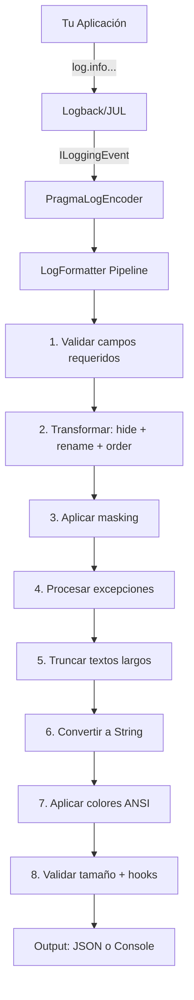

# Pragma Log Library

**pragma-log** es una librería de logging estructurado para Java 21 que estandariza los logs en microservicios con soporte para múltiples frameworks y herramientas de observabilidad.

## ¿Qué resuelve?

- Logs estructurados (JSON/Console) sin cambiar cómo logeas (`log.info(...)` sigue funcionando)
- Enmascaramiento automático de datos sensibles (passwords, tarjetas, tokens)
- Campos configurables: ocultar, renombrar, reordenar, agregar
- Captura automática de contexto HTTP (requestId, traceId, headers)
- Compatible con OpenTelemetry, ELK, Datadog

## Arquitectura



## Módulos

| Módulo | Dependencia Gradle | Para qué |
|--------|-------------------|----------|
| `logging-spring` | Spring Boot MVC | Apps Spring imperativas |
| `logging-reactive` | Spring WebFlux | Apps reactivas |
| `logging-java` | Java puro | Apps sin framework |
| `logging-quarkus` | Quarkus | Apps Quarkus con CDI |

## Inicio rápido (Spring Boot)

```groovy
// build.gradle
dependencies {
    implementation 'co.pragma.logging:logging-spring:1.0.0-SNAPSHOT'
}
```

```yaml
# src/main/resources/pragma-log-config.yml
formatter: JSON
formatterOptions:
  timestampFormatter: yyyy-MM-dd HH:mm:ss.SSS
  prettyPrint: true
appName: mi-servicio
masking:
  enabled: true
  character: "*"
  defaultType: FULL
```

```java
@SpringBootApplication
@ComponentScan(basePackages = {"com.myapp", "co.pragma.logging.spring"})
public class MyApp {
    public static void main(String[] args) {
        SpringApplication.run(MyApp.class, args);
    }
}
```

**Resultado:**
```json
{
  "timestamp" : "2026-01-15 10:30:22.456",
  "level" : "INFO",
  "message" : "User logged in",
  "logger" : "com.myapp.UserService",
  "thread" : "http-nio-8080-exec-1",
  "requestId" : "a1b2c3d4-5678-90ab-cdef"
}
```

## Características principales

- **Zero-config logging**: solo agrega la dependencia y el YAML
- **Masking automático**: `@MaskedLogField` en tus DTOs
- **Campos flexibles**: hideFields, renameFields, fieldsOrder, additionalFields
- **Dos formatos**: CONSOLE (human-readable) y JSON (observabilidad)
- **Hooks**: alertas cuando logs exceden tamaño máximo
- **Colores ANSI**: configurable por nivel de log
- **Thread-safe**: singleton con volatile + synchronized
- **Alta performance**: FieldSchemaOptimizer pre-computa transformaciones
